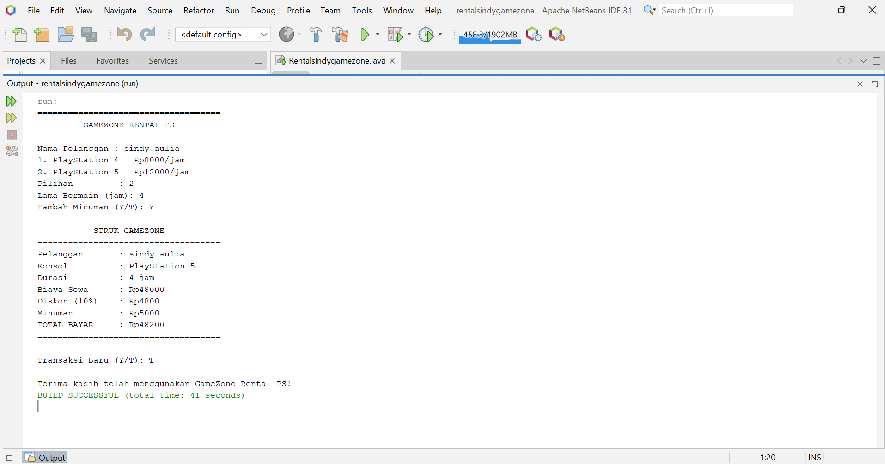

# 🎮 Rental Sindy Game Zone

**Rental Sindy Game Zone** adalah aplikasi penyewaan game yang dirancang untuk membantu pengelolaan data penyewaan secara lebih mudah, terstruktur, dan efisien.

## 📌 Deskripsi Proyek

Proyek ini dibuat sebagai aplikasi rental game untuk mengelola informasi penyewaan, data pelanggan, dan transaksi penyewaan.

## ✨ Fitur Aplikasi

- 🎮 Pengelolaan data game atau konsol
- 👥 Pengelolaan data pelanggan
- 📝 Pencatatan transaksi penyewaan
- 💰 Pengelolaan biaya sewa
- 📋 Informasi data penyewaan

## 🛠️ Teknologi yang Digunakan

Sesuaikan dengan teknologi yang digunakan dalam proyek:

- Bahasa pemrograman: **[isi bahasa pemrograman]**
- Editor: **[isi editor yang digunakan]**
- Penyimpanan data: **[isi jika menggunakan database atau file]**

## 📷 Screenshot Aplikasi

Tambahkan screenshot aplikasi pada bagian ini.

Pastikan nama folder dan file gambar sesuai dengan yang ada di repository GitHub.

## 🚀 Cara Menjalankan Aplikasi

1. Unduh atau clone repository ini.
2. Buka proyek menggunakan editor yang sesuai.
3. Pastikan perangkat telah memiliki teknologi yang diperlukan.
4. Jalankan aplikasi sesuai dengan jenis proyeknya.

## 👩‍💻 Pengembang

**Nama:** Sindy  
**Proyek:** Rental Sindy Game Zone

---

*Dibuat untuk memenuhi kebutuhan proyek pembelajaran pemrograman.*
